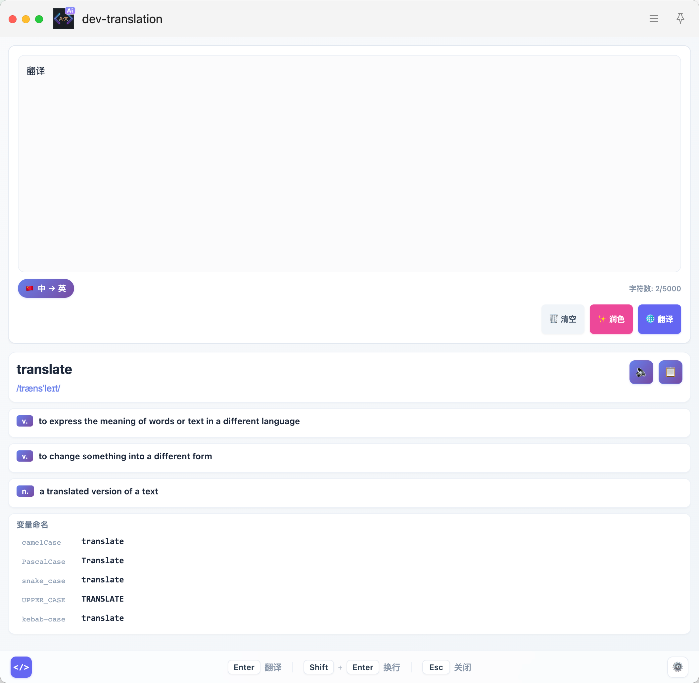

# Dev Translation - 开发者翻译

专为开发者设计的 uTools 智能翻译插件，提供中英文互译、文本润色、变量命名等实用功能。



## 核心特性

### 智能翻译

- 自动检测输入语言，智能切换翻译方向
- 支持 **8 种翻译引擎**：uTools AI（结构化翻译）、第三方 AI（OpenAI 兼容 API）、Google 翻译（多来源分时尝试、可选专用代理）、DeepL 官方、DeepLX 自部署、百度标准版、阿里云 TranslateGeneral、彩云小译 API；后三家使用官方 HTTPS 文本接口，需自行申请对应凭据
- **引擎开关与故障转移**：可在设置中为每类引擎单独开启/关闭；关闭项不参与自动翻译、AI 检测/润色/命名与批量测试，但保留全部配置与历史统计。主引擎是顺序中**首个开启项**（即使尚未配置，调用时跳过）；全部关闭时明确提示「请至少开启一个翻译引擎」，不会隐式改用 uTools AI。主引擎失败或超时时按顺序自动切换至下一开启项；每个引擎默认 5 秒内未取得译文即视为失败（可在设置中改为 1–60 秒）；自定义 AI 可配置多组备用，轮到该引擎时按组顺序尝试且使用独立的组超时；未配置、翻译服务未加载或百度超 1000 / 阿里超 5000 字符的引擎会跳过而不计入失败率；彩云不设未经确认的本地上限
- 单词/词组结果可显示美式 IPA 音标、释义和例句：主译文先展示，资料补全在后台独立进行（整段最长 5 秒，不占用引擎超时、不影响成功率统计）。英译中显示中文释义，中译英显示英文解释性释义，每次最多 3 条；音标只采用来源明确标注美式（US/GA/GenAm）的读音，无法确认口音时显示「暂无音标」，不把英式或未标地区的音标当作美式。固定词组按整组词条命中，不拆词拼接；句子不新增词典查询
- 随插件打包了一份本地双语词库（约 5,000 个常用单词 + 约 500 个常见固定词组，含美式 IPA、中文释义与英文释义），查询不联网、运行时不下载也不自动更新；在线词典只用于补充它来源上能够合法满足的字段（不含口音无法确认的音标），且只服务单个英文单词

### 变量命名助手

命名区最多两行，每行 5 个格式标签，行内横向滚动、点击即复制完整名称：

- **常规命名**（「显示变量命名」开关）：单词、短语和句子的英文文本生成 5 种格式（中译英取译文，英译中取原文）——**camelCase**、**PascalCase**、**snake_case**、**UPPER_CASE**、**kebab-case**
- **AI 命名**（「AI 命名」开关，默认关闭）：开启后按用途判断是否需要命名，并给出一个合适的英文语义名称（如「发现的数量」→ discovery + count），再在本地转换为同一套 5 种格式；不适合命名时显示「无需变量命名」。支持中英文单词、词组与 200 字符以内的用途描述短句；每次成功翻译自动生成一次，失败或超时可只重试命名

两个开关彼此独立：只开常规、只开 AI、两行同时显示或整个命名区隐藏都可按需组合。AI 命名会额外联网发送本次原始输入与主译文并消耗 AI 额度，只使用**已开启**的 AI 来源（uTools AI / 自定义 AI 组）按顺序尝试，整轮最长 10 秒；已关闭的 AI 来源不会参与。

### 文本润色

将技术文本改写为易于理解但保留适当专业性的表达，支持采纳或拒绝润色结果。润色与 AI 语言检测都按设置中已开启的 AI 来源顺序回退：uTools AI 单次受引擎响应超时约束，自定义 AI 每组受组超时约束；首个有效结果即采用，全部不可用时只提示一次并保留原文。

### 配置面板

全屏设置页面分为「常规 / 引擎 / 高级」三类（宽窗口侧栏、窄窗口顶部标签），支持：

- 常规：语言检测策略（正则算法 / AI 模型；AI 策略下按已开启 AI 来源顺序回退，全部不可用时回退本地字符规则并提示一次）；输出设置按当前有效主引擎（顺序中首个开启项）展示可用选项（音标、释义、词性、例句、常规命名、AI 命名、语境说明），对所有主引擎都可见；无启用引擎时提示先开启并保留已保存偏好；「显示词性」默认开启（关闭只隐藏 n./v./adj. 等标签，释义含义不变），「AI 命名」默认关闭
- 引擎：排序列表每行只展示图标、名称、拖拽柄、P 序号与状态（主引擎 / 已关闭 / 未配置，位于 P 序号左侧同行显示）；宽窗可拖动列表右侧分隔条调整宽度（也支持方向键微调，不持久化），窄窗保留上下布局。**启停由右侧详情标题栏的「启用引擎」滑动开关控制**（位于「测试配置」左侧，只作用于当前选中的引擎，不改变编辑焦点与顺序）；uTools AI 与自定义 AI 为 AI 类、其余六类为 MT（共享固定分类，不再在列表显示标签）；关闭项仍可选中编辑、手动「测试配置」或拉取模型（会真实请求并可能产生费用）。拖拽调整优先级，**首个开启项为目标主引擎**，页面顶部显示当前主引擎或「无启用引擎」；一键测试与按稳定性排序只对开启项生效，关闭项显示「已关闭，未测试」并统一排在末尾。配置 8 种翻译引擎的凭据与引擎响应超时；自定义 AI 多组配置及共用系统提示词；DeepL / DeepLX 与百度（APP ID + 密钥）、阿里云（AccessKey ID + Secret，需开通服务及 `alimt:TranslateGeneral` 权限）、彩云（开放平台 API Token，普通会员账号不等于 Token）的独立配置；Google 可选专用代理；选中引擎「测试配置」与「一键测试并排序」（可能消耗服务额度，与高级区按历史成功率排序相互独立）。凭据沿用本机 uTools `dbStorage`，**并非加密存储**
- 阿里凭据获取：在「引擎 → 阿里」可直达机器翻译产品页和 RAM 用户管理；在 RAM 用户的「凭证管理」创建 AccessKey，Secret 仅创建时可见，勿使用主账号密钥
- 高级：进入后直接显示稳定性统计与日志管理（成功/失败/跳过；日志仅保留类别、状态码、来源/路径等最少元数据），无需二次展开
- 实时生效、自动持久化；分类选择不保存，每次进入默认「常规」

## 使用方法

### 触发插件

- **关键词触发**：在 uTools 中输入 `翻译`、`translate` 或 `fanyi`
- **文本选择触发**：选中文本后右键选择"翻译"

### 快捷键

| 快捷键 | 功能 |
|--------|------|
| `Enter` | 执行翻译 |
| `Shift + Enter` | 输入换行 |
| `Esc` | 关闭插件 |

### 快捷操作

- 左下角 `</>` 按钮：切换变量命名模式
- 左下角引擎按钮：在**开启的**引擎之间轮换主引擎（关闭项保持原位、不会被启用）；无开启项时显示「无启用」并跳转到设置的引擎分类
- 右下角 `⚙️` 按钮：打开设置页面
- 底部 `⭐ 好用就 Star` 链接：跳转 GitHub 仓库
- 左键语言徽章：手动切换翻译方向
- 右键语言徽章：重新自动检测

## 技术栈

- **前端框架**：Vue 3 (Composition API)
- **构建工具**：Vite 6.x
- **包管理器**：pnpm
- **运行环境**：uTools 插件环境

## 系统要求

- [uTools](https://u.tools/) 应用
- uTools AI 服务（使用 AI 翻译功能时需要）
- 网络连接

## 开发

```bash
# 按锁文件安装依赖（开发与构建已验证 Node 26.7.0 / pnpm 12.6.0）
pnpm install --frozen-lockfile

# 开发模式
pnpm dev

# 隔离回归测试
pnpm test

# 构建（包含项目 LICENSE 与第三方许可文本）
pnpm build
```

`vue-router` 保持在 5.0.x：5.1+ 的 Vite peer 要求超出本项目 Vite 6，不应只为追新盲目升级。

开发调试在 uTools「插件管理 → 开发者 → 添加开发插件」选择**项目根目录**（`pnpm dev`，端口 5175）；验证打包形态时另选 **`dist/`**，二者不是同一实例。隔离测试与构建通过不替代真实宿主验收，详见 [TESTING.md](./TESTING.md)。

## 隐私与安全

这是联网翻译插件，并非离线翻译器：原文会发送给所选引擎；故障转移可能依次发送给多个配置引擎，英文单词的资料补全可能查询外部词典，AI 语言检测、润色和**已开启**的 AI 命名也可能发送文本（AI 命名只发送本次原始输入与主译文，不发送历史内容，关闭时不会预请求）。

本地词库是随包数据，查询本身不联网；这不代表主翻译或 AI 命名可以离线使用。

API 凭据保存在 uTools `dbStorage`，**未加密**。自定义 AI / DeepLX 的远程 HTTP 地址会明文传输原文及凭据，建议使用 HTTPS；本机自部署地址应仅用于可信环境。Google 免费翻译来源并非官方付费 API，无可用性承诺；使用所有第三方服务时须遵守对应条款和额度限制。

外部例句以安全文本节点显示，保留关键词高亮，不执行返回内容中的 HTML。更多安全边界及漏洞报告注意事项见 [SECURITY.md](./SECURITY.md)。

## 开源许可与分发

Copyright (C) 2026 zhongyuming

当前版本的自有代码、提示词、文档及自有素材采用 **[GPL-3.0-only](./LICENSE)**（仅 GNU GPL 第 3 版）。允许商业使用、修改和再分发，但须履行 GPL 的许可、版权保留及对应源码提供等义务；不附带任何担保。

第三方组件仍保留各自版权和许可，GPL 不替代外部服务条款，也不授予第三方商标权。构建自动生成 `dist/LICENSE`、`dist/NOTICE` 与 `dist/THIRD_PARTY_NOTICES.txt`，打包分发时不得删除；preload 依赖自身的 LICENSE 同样保留。

本地词库数据来自可再分发的公开数据源（ipa-dict / CMUdict、Wikipedia 词频、Open English WordNet、en/zh Wiktionary），其许可与仓库代码许可相互独立：代码为 GPL-3.0-only，词库中由 Wiktionary 衍生的内容继续以 CC BY-SA 4.0 相同方式共享，WordNet 释义以 CC BY 4.0 署名使用。构建会额外生成 `dist/DICTIONARY_LICENSES.txt`，并保留 `dist/preload/dictionary/SOURCES.json`、`manifest.json`、`COVERAGE.md` 与 `LICENSES/`，缺失许可文本时构建失败。

分发安装包时，应同时提供与该产物对应的完整源码（含构建脚本与锁文件），推荐随包附同版源码归档，并注明对应提交；不要只链接不断变化的主分支。完整验证流程见 [TESTING.md](./TESTING.md)。uTools 宿主自身不属于本项目 GPL 授权范围，二者结合的分发许可边界需另行核对。

开源准备检查与尚待处理事项见 [审计报告](./docs/open-source-audit.md)。

## 版本历史

当前版本：**1.5.0**。详见 [CHANGELOG.md](./CHANGELOG.md)。

项目仓库：[puppetdevz/dev-translation](https://github.com/puppetdevz/dev-translation)。

最后更新：2026-10-13。

## Star 历史

[](https://star-history.com/#puppetdevz/dev-translation&Date)
